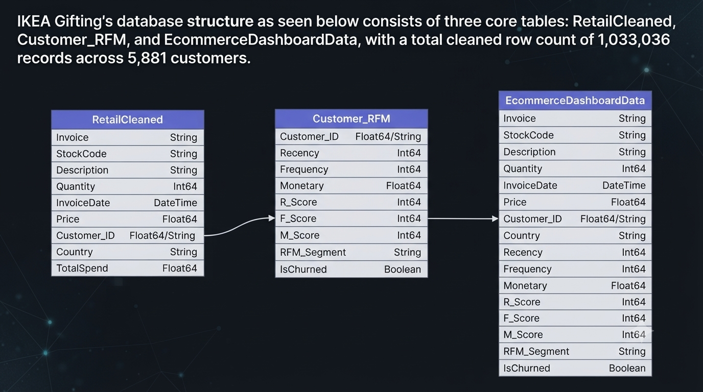

## E-commerce-Customer-Behaviour-Retention-Analysis-SQL-Server-Python-Power-BI
### Overview
#### This project analyzes two years of retail transaction data (December 2009 to December 2011) for IKEA Gifting, a UK-based online retailer specializing in giftware and home decor. The goal is to group customers using RFM (Recency, Frequency, Monetary) analysis, flag churn risk (customers inactive for more than 90 days), and export clean data for reporting and dashboarding.
### Data Structure and Overview:

### Executive Summary
## Executive Summary

#### Across two years of UK online retail transactions (December 2009 – December 2011), IKEA Gifting generated strong top-line revenue heavily driven by a small core of repeat buyers, while overall customer retention showed significant drop-off. Across **5,881 active customers** and **1,033,036 cleaned transaction records**, **Champions** represent **22.0%** of the buyer base (1,291 customers) yet generate **68.1%** of total revenue (**11.84M**). However, **50.9%** of customers have become inactive (90+ days since last purchase), including **665 high-value buyers** representing **2.38M** in revenue at risk. The following sections break down the key segment trends, churn drivers, and actionable retention opportunities.

Below is the overview page from the Power BI dashboard, and additional visuals are included throughout the report. The interactive dashboard file can be downloaded [here](YOUR_PBIX_LINK).
