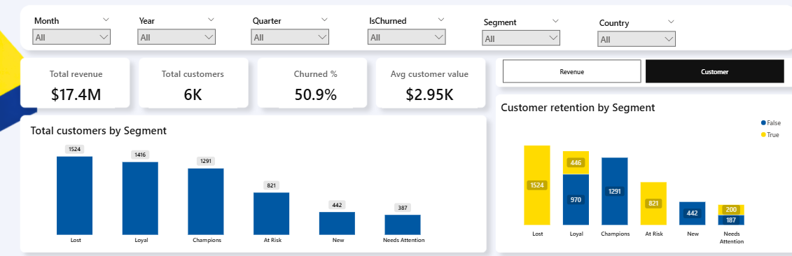
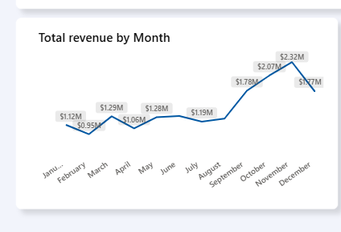
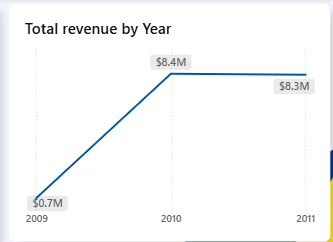
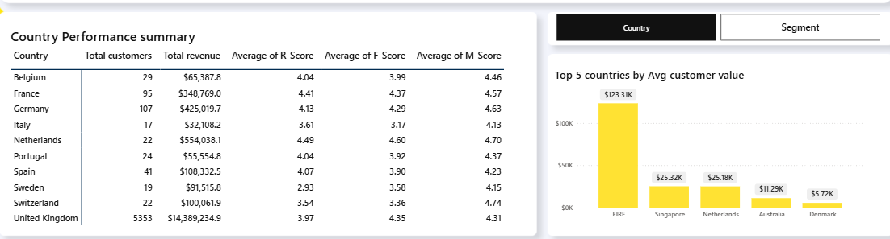

## E-commerce-Customer-Behaviour-Retention-Analysis-SQL-Server-Python-Power-BI
### Overview
#### This project analyzes two years of retail transaction data (December 2009 to December 2011) for IKEA Gifting, a UK-based online retailer specializing in giftware and home decor. The goal is to group customers using RFM (Recency, Frequency, Monetary) analysis, flag churn risk (customers inactive for more than 90 days), and export clean data for reporting and dashboarding.
### Data Structure and Overview:

 ### Executive Summary

#### Across two years of UK online retail transactions (December 2009 – December 2011), IKEA Gifting generated strong top-line revenue heavily driven by a small core of repeat buyers, while overall customer retention showed significant drop-off. Across **5,881 active customers** and **1,033,036 cleaned transaction records**, **Champions** represent **22.0%** of the buyer base (1,291 customers) yet generate **68.1%** of total revenue (**11.84M**). However, **50.9%** of customers have become inactive (90+ days since last purchase), including **665 high-value buyers** representing **2.38M** in revenue at risk. The following sections break down the key segment trends, churn drivers, and actionable retention opportunities.

 

### Sales & Revenue Trends:

#### 1) Strong Q4 Gifting Seasonality: Monthly revenue rises steadily from an early-year low of $0.95M in February to a peak of $2.32M in November and $1.77M in December, lifting Q4 revenue to $6.2M—nearly double Q1 ($3.4M) and Q2 ($3.6M).

#### 2) Year-over-Year Scale & Stabilization: Annual revenue surged from $0.7M in 2009 (partial year starting December) to $8.4M in 2010, and held steady at $8.3M in 2011 across 5,881 active customers ($17.4M total revenue, $2.95K average customer value).

#### 3 )Geographic Revenue Split: The United Kingdom drives the bulk of revenue at $14.39M across 5,353 customers, while international markets like EIRE ($123.31K), Singapore ($25.32K), and Netherlands ($25.18K) lead in average customer value.

### Recommendations:

#### Based on the RFM segmentation, revenue concentration, and churn trends identified in the analysis, IKEA Gifting can prioritize the following actions:

#### - Launch Targeted Win-Back Campaigns for High-Value Lapsed Buyers: Focus immediate reactivation outreach on the 821 At Risk customers ($1.59M in historical spend) and the 665 inactive high-monetary buyers (Recency > 90, Monetary score ≥ 4, representing $2.38M at risk) using personalized seasonal reminders and time-bound gift vouchers ahead of Q4 peak demand.
#### - Protect and Retain Champions with VIP Loyalty Perks: Since Champions (1,291 customers, 22.0% of the base) generate 68.13% of total revenue ($11.84M), introduce early holiday catalog access, bundled gifting discounts, and dedicated account perks to prevent top-tier attrition.
#### - Convert Early-Stage and Slipping Tiers Before the 90-Day Cutoff: Set up automated 30- and 60-day post-purchase email flows targeting New (442 buyers), Needs Attention (387 buyers), and the 446 inactive Loyal customers to drive second orders before they cross the 90-day churn threshold.
#### - Capitalize on Q4 Gifting Seasonality and High-AOV International Markets: Front-load inventory and marketing spend in September–November (when monthly revenue surges from $1.78M to $2.32M and churn drops to 23.4%) while expanding B2B/bulk gifting outreach in high-average-value markets like EIRE ($123.31K avg), Singapore ($25.32K avg), and Netherlands ($25.18K avg).

